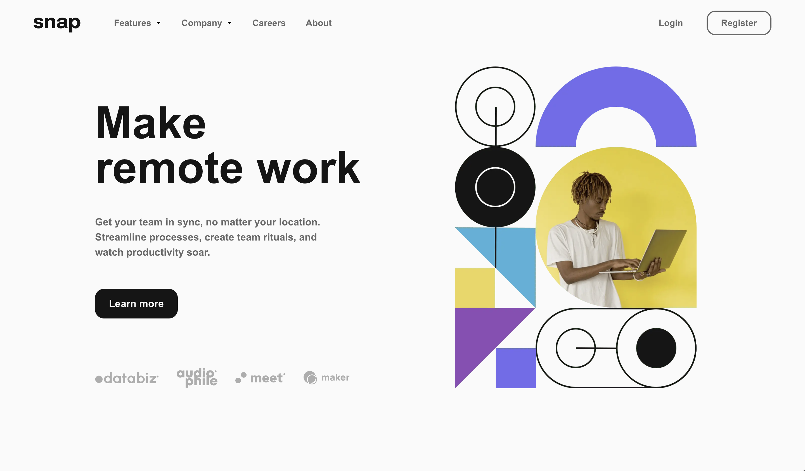

# Frontend Mentor - Intro section with dropdown navigation solution

This is a solution to the [Intro section with dropdown navigation challenge on Frontend Mentor](https://www.frontendmentor.io/challenges/intro-section-with-dropdown-navigation-ryaPetHE5). Frontend Mentor challenges help you improve your coding skills by building realistic projects.

## Table of contents

- [Overview](#overview)
  - [The challenge](#the-challenge)
  - [Screenshot](#screenshot)
  - [Links](#links)
- [My process](#my-process)
  - [Built with](#built-with)
  - [What I practiced](#what-i-practiced)
  - [Continued development](#continued-development)
  - [Useful resources](#useful-resources)
- [Author](#author)

## Overview

### The challenge

Users should be able to:

- View the relevant dropdown menus on desktop and mobile when interacting with the navigation links
- View the optimal layout for the content depending on their device's screen size
- See hover states for all interactive elements on the page

### Screenshot

### Links

- Solution URL: 
- Live Site URL: https://intro-section-ecru-gamma.vercel.app/

## My process

### Built with

- [React](https://reactjs.org/) - JS library
- [Next.js](https://nextjs.org/) - React framework
- [Tailwind](https://tailwindcss.com)
- [Sonner](https://ui.shadcn.com/docs/components/radix/sonner)
- Flexbox
- Mobile-first workflow

### What I practiced

After taking a break, I spent this session refreshing my core front-end skills. I focused on writing semantic HTML and styling components with Tailwind CSS, including building custom dropdown menus and applying a mobile-first responsive design approach.

### Continued development

Now that I have refreshed the fundamentals, I plan to take on larger, multi-component projects to gain deeper practical experience and keep improving my workflow.

### Useful resources

- [DevDocs](https://devdocs.io) - An essential resource for reading documentation offline when power outages are part of your daily schedule.

## Author

- Website - [Dmytro Farbun](https://my-portfolio-main-eta-jade.vercel.app/)
- Frontend Mentor - [@Diamond-FoxUA](https://www.frontendmentor.io/profile/Diamond-FoxUA)
- LinkedIn - [@dmytro-farbun](https://www.linkedin.com/in/dmytro-farbun)
